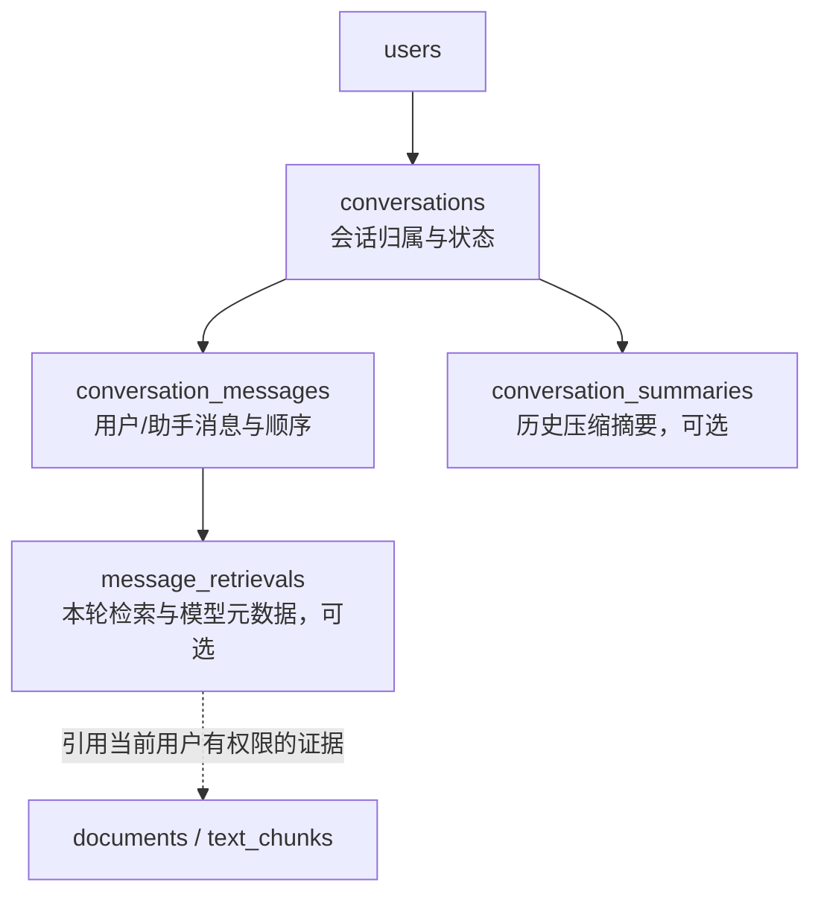

# 多轮对话记忆：数据边界与演进路线

> 状态：2026-11-04，M1 会话与消息持久化，以及 M2 第一片助手消息占位、
> Answer Job、latest、opaque cursor、参数、来源与 Token、会话管理，以及 standalone/linked 终态保留策略；
> 已分别提交为 `d64170c` 和 `e1977e5`；完整代码门禁、隔离 PostgreSQL 集成、持久开发库迁移、本地 HTTP 冒烟和三轮真实 Generation 已通过。
> 历史消息尚未进入 Generation Prompt，SSE、摘要、来源快照和记忆召回仍未实现。
>
> 本文描述个人用户 RAG 从“单次带来源问答”演进到“有限、可追溯的多轮对话”的数据模型和并发边界。它不承诺 Agent、长期人格记忆或跨用户共享。

## 1. 当前事实与目标

当前存在两条回答路径，完成度不同：

- `POST /answers` 仍是无状态单轮问答：请求携带当前问题和可选文档范围，后端在当前 `OwnerScope` 内检索 chunks 和 vectors，生成带来源的回答后返回，不保存会话历史；
- 当前工作区的 `/conversations` 候选链路已经通过迁移 29 持久化 `conversations` 和 `conversation_messages`，并通过迁移 30 将用户消息、助手 `generating` 占位和 Answer Job 关联。刷新页面后可以恢复已经写入 PostgreSQL 的会话与消息。

“能够恢复消息历史”和“回答使用历史上下文”是两个独立能力。当前 Generation 仍只消费本轮问题，尚未读取最近消息或摘要；Answer Job 可以保存本轮来源与 Token，但会话消息还没有独立、稳定的历史来源快照。因此当前实现属于持久化会话与异步单轮回答，尚不能称为完整多轮记忆。

多轮记忆的目标不是把全部聊天记录塞进 Prompt，而是在每轮回答前，受控地选择“最近轮次 + 已验证摘要 + 当前用户文档证据”。

```text
当前问题
  + 最近若干消息
  + 已覆盖旧消息的会话摘要（可选）
  + OwnerScope 内实时 RAG 检索证据
  → 有限长度 Prompt
  → 带来源的回答
```

## 2. 当前已实现与计划中的关系模型



前两张表已经由迁移 29 实现；迁移 30 建立 Answer Job 关联，迁移 31 保证每个非空 `user_message_id`
最多关联一个 Answer Job，迁移 32 增加 latest 索引，迁移 33～36 冻结 standalone 清理、文档删除、不可变
请求参数和来源文档隐私门禁，迁移 37 一次性清理升级前的不安全 standalone 来源；摘要和独立历史证据快照仍是 M3 计划：

| 表 | 核心字段 | 责任 | 当前状态 |
| --- | --- | --- | --- |
| `conversations` | `id`、`owner_user_id`、`title`、`status`、`last_message_at`、`created_at` | 对话归属根；所有消息读写先按 owner 限定 | M1 工作区候选已实现 |
| `conversation_messages` | `id`、`conversation_id`、`sequence_no`、`role`、`content`、`status`、`client_message_id`、`created_at` | 保存用户问题、助手回答及生成状态；`(conversation_id, sequence_no)` 唯一 | M1/M2 工作区候选已实现 |
| `conversation_summaries` | `conversation_id`、覆盖的消息序号范围、`content`、`model_name`、`created_at` | 压缩已较旧的历史；摘要永远不能替代原消息 | M3 计划，未实现 |
| `message_retrievals` | `assistant_message_id`、`document_id`、页码、chunk 内容哈希/快照、模型和检索参数 | 让历史回答可以解释“当时引用了什么”，避免文档重解析后仅靠当前 chunk ID 失真 | M3 计划，未实现 |

`conversations.owner_user_id` 是唯一的会话归属根；`messages`、`summaries` 和 `retrievals` 通过 `conversation_id` 回溯，不重复保存用户 ID。查询必须在 SQL 层通过 `conversations.owner_user_id = current_owner` 限定，沿用现有 `OwnerScope` 原则。

## 3. 当前写入链路与后续目标

M1 的消息保存接口只持久化用户消息，不触发远程模型：

```text
POST /conversations/:id/messages（Cookie → OwnerScope）
  → 锁定该用户自己的 conversations 行
  → 校验会话可用、输入长度和 client_message_id
  → 写入 user message，分配稳定 sequence_no
  → 返回新消息；相同 ID 与相同正文按幂等重放返回
```

M2 第一片通过单独接口创建异步回答，目前仍只使用本轮问题：

```text
POST /conversations/:id/answer-jobs（Cookie → OwnerScope）
  → 锁定该用户自己的 conversations 行
  → 在同一事务中写入 user message 与 assistant/generating 占位
  → 创建并关联 Answer Job
  → Worker 按本轮 query 在同一 OwnerScope 内执行检索和 Generation
  → 成功时一次性写入最终答案；失败或 queued 取消时收尾占位消息
  → 前端按已知 Job ID 轮询并刷新消息终态
  → 页面重新进入时按 conversation ID 恢复随会话保留的 latest linked Job
  → queued/processing 继续轮询；终态恢复重试、来源和 Token 快照
```

M3 才会在回答前受控读取“最近若干消息 + 已验证摘要 + 当前证据”，并设置上下文 Token 预算。SSE 只负责传输生成中的增量内容；不应把每个 token 写入 PostgreSQL。最终答案、终态和来源快照仍应一次性持久化，取消、超时或进程中断必须明确收尾为 `interrupted` 或 `failed`。

## 4. 与当前 RAG、重解析和向量化的关系

会话记忆只提供对话上下文，不替代实时检索：

- 每轮仍按当前用户的文档范围重新检索，不能把上一轮检索结果永久当作事实；
- 文档删除、重新解析、重分块或重新向量化后，新的回答必须基于当前可用证据；
- 历史回答的引用若只保存 `chunk_id`，会在重解析时因 chunk 删除而失效。因此第二阶段应保存文档版本、页码和内容哈希/必要快照；
- 第一版不把消息向量化。只有出现“跨历史消息语义召回”这一可测需求时，才评估单独的 memory embeddings。

## 5. 容量、并发与安全边界

多轮记忆会增加数据库读写和 Prompt Token，不应绕过现有问答闸门。第一版至少需要：

| 风险 | 设计约束 |
| --- | --- |
| 同一会话连续点击发送 | `client_message_id` 幂等；锁定会话行后分配消息顺序 |
| 同一会话两个回答同时生成 | 默认每个会话最多 1 条 `generating` 助手消息；返回稳定 `409` 或提示等待，不能靠 Handler `sleep` |
| 终态任务使用同一客户端 ID 重放 | 同一 ID 只用于同一轮网络重放；业务重试必须创建新 ID，并补充终态重放的数据库边界测试 |
| 页面刷新后丢失活动任务控制 | 使用 `GET /conversations/:id/answer-jobs/active` 发现活动任务，再恢复轮询和 queued 取消 |
| 归档后继续写入 | archived 会话保持历史可读，但拒绝新消息、新回答和业务重试；恢复 active 后重新开放写入 |
| 崩溃留下无 Job 的 generating 占位 | 归档事务在无活动 Job 时将孤立占位原子收尾为 `interrupted`，避免永久阻塞归档 |
| 删除与生成并发 | 删除先锁 conversation 并拒绝 queued/processing Job；无活动任务时依赖外键级联删除消息和关联 Job |
| 单个用户长对话拖垮模型 | 限制单消息字符/Token、最近轮次和摘要长度；问答仍受用户级与全局并发、频率和费用预算控制 |
| 多实例下顺序错乱 | 会话顺序与生成状态在 PostgreSQL 事务中判断；跨实例模型并发槽位在 P100-4 再使用 Redis 协调 |
| 数据删除 | 会话删除级联消息、摘要和检索记录；用户注销策略必须先处理其文档与会话归属，不能留下无主对话 |

Redis 仅适合短暂的 SSE 事件中转、连接状态、跨实例限流或全局模型槽位。消息、摘要、会话归属、最终生成状态和引用都必须由 PostgreSQL 保存；Redis 丢失后必须能从数据库恢复页面和任务状态。

## 6. 分阶段实施与验收

| 阶段 | 交付 | 当前状态 | 验收重点 |
| --- | --- | --- | --- |
| M0 | 单轮有来源问答，无持久会话 | 已提交基线 | 问答 OwnerScope、引用与容量闸门正确 |
| M1 | `conversations`、`conversation_messages`、创建/读取会话和消息 | 第一片已提交；隔离 PostgreSQL 集成通过 | 两个用户不能读取或猜测彼此会话；重复提交只写一条用户消息 |
| M2 | 异步 Answer Job、latest 恢复、cursor、参数、结果、会话管理、取消和故障收尾 | 第一片已提交并通过真实 Generation；SSE 待完成 | 消息历史稳定遍历；归档只读；删除级联；来源和 Token 使用 Job 快照 |
| M3 | 最近历史、摘要、上下文 Token 预算、来源快照 | 未实现 | 长会话成本受控；文档重解析后历史回答仍可解释 |
| M4（按指标） | Redis 跨实例事件和槽位、可选 memory retrieval | 未实现 | 多实例不打乱顺序、不突破 Provider 容量 |

实施前应补充评测集：单轮事实问答、多轮指代/追问、文档更新后的追问、无证据拒答和跨用户越权尝试。只有能用这些样本证明多轮正确率或体验提升，才扩大为 Agent 编排或长期记忆。

## 7. 当前已知缺口

- 会话列表和消息历史已经切换到版本化 opaque cursor，旧 page/offset 接口保留用于滚动部署回退。消息 cursor 绑定不可变 `sequence_no`，可以稳定遍历历史；会话 cursor 基于可变 `updated_at,id`，属于动态 feed，通过刷新头批次和 ID 合并捕获跳到前方的更新，不承诺跨请求数据库快照；
- 会话页已支持 `document_id`、`top_k`、`response_language` 以及 latest linked Job 的来源和 Token；linked Job 随会话生命周期保留，前端当前只展示 latest，更早 turn 尚无按消息打开对应 Job 的入口；
- 删除指定文档会立即清理 standalone Job；linked Job 保留并把 live 文档外键置空，同时用 `requested_document_id` 保持原请求范围。新 turn 重试已删除文档返回 404，不会扩大为全部文档；
- 全库 standalone 结果若 sources 引用被删文档也会立即清理；处理中的任务成功收尾前重新验证来源文档，删除抢先时进入 failed 且不保存 answer/sources/Token；
- retained Job 的 sources 仍缺少文档 revision、证据正文或内容 hash，因此长期保存 Job 不等于 M3 的独立历史证据快照；
- 相同 `client_message_id` 的并发重放和队列失败清理已经通过真实 PostgreSQL 测试；后续业务重试仍必须创建新 ID；
- conversation-linked `client_message_id` 幂等凭据保留到会话删除；standalone Job 仍按 TTL 清理，清理后的请求不再具备永久回放语义；
- `ANSWER_JOBS_ENABLED` 默认关闭；本地持久开发库已应用迁移 29～37，并完成单用户顺序执行的真实远程 Generation；其他目标数据库发布前仍需确认迁移版本，k6 混合场景尚未验收。

## 8. 与现有路线的对齐

- 当前 100 人计划优先解决任务背压、Worker 角色、多实例安全和跨实例协调；多轮记忆不应抢在这些基础前引入。
- M1/M2 会增加在线问答读写压力，必须纳入后续 k6 混合场景，但不改变 `documents`、`document_jobs`、`embedding_jobs` 的正式状态机。
- 当前 M2 第一片的前端再次提交会创建新的会话 turn，不重置已经失败或取消的旧任务；queued 才允许取消，processing 进入不可取消状态后继续轮询。
- 任何 Agent 都应建立在 M1～M3 的受限上下文、OwnerScope、工具白名单、最大轮次、超时与成本预算之上，而不是替代这些数据边界。
